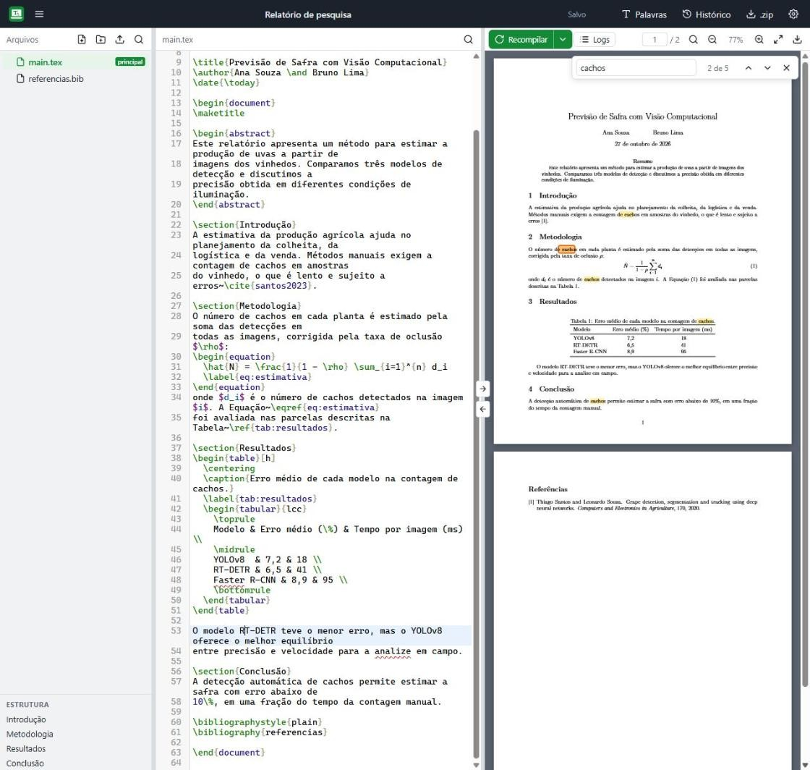
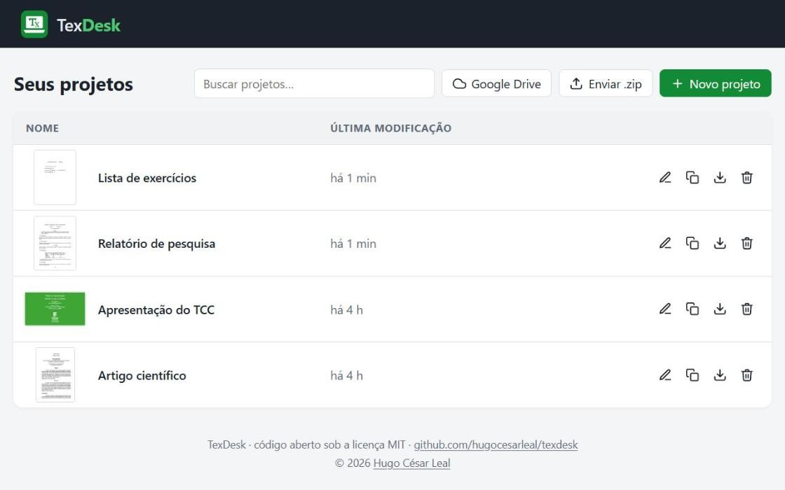
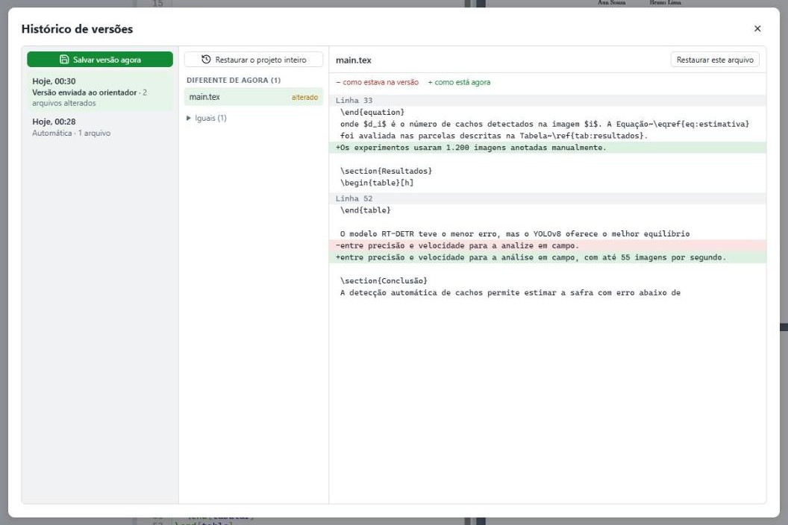

<p align="center"></p>

<h1 align="center">TexDesk</h1>

<p align="center"><b>Editor LaTeX que roda no seu computador.</b><br>Escreva, compile e veja o PDF lado a lado, sem conta, sem limite de tempo de compilação e sem depender da internet.</p>

<p align="center">
  <a href="https://github.com/hugocesarleal/texdesk/releases/latest"></a>
  <a href="https://github.com/hugocesarleal/texdesk/actions/workflows/tests.yml"></a>
  
  <a href="LICENSE"></a>
</p>

<p align="center">
  <a href="#instalação">Instalação</a> ·
  <a href="#recursos">Recursos</a> ·
  <a href="#atalhos-de-teclado">Atalhos</a> ·
  <a href="#google-drive">Google Drive</a> ·
  <a href="#solução-de-problemas">Solução de problemas</a> ·
  <a href="#desenvolvimento">Desenvolvimento</a>
</p>

<p align="center"></p>

## Por que o TexDesk

- **Local de verdade.** Seus projetos são pastas comuns no seu computador. O TexDesk funciona sem internet depois de instalado, e nada sai da sua máquina a não ser que você ligue o Google Drive.
- **Sem limites.** Não há tempo máximo de compilação nem limite de projetos ou de colaboradores. Documentos grandes, como TCCs e teses, compilam no seu processador.
- **Pronto para usar.** Os pacotes de instalação já trazem o motor LaTeX ([Tectonic](https://tectonic-typesetting.github.io/)) e o biber. Os pacotes LaTeX que cada documento usa são baixados sozinhos na primeira compilação.
- **Feito para o dia a dia acadêmico.** Inclui modelos de artigo e de slides do IFMG, corretor ortográfico em português, histórico de versões e contagem de palavras.

## Instalação

É preciso ter o [Python 3.10 ou mais novo](https://www.python.org/downloads/). No Windows, marque **Add Python to PATH** durante a instalação.

Baixe o pacote do seu sistema na [página de releases](https://github.com/hugocesarleal/texdesk/releases/latest):

| Sistema | Arquivo | Como abrir |
|---|---|---|
| Windows 10/11 (64 bits) | `texdesk-…-windows-x64.zip` | Extraia e dê dois cliques em `iniciar.bat` |
| Linux (Intel/AMD 64 bits) | `texdesk-…-linux-x64.tar.gz` | Extraia e rode `./iniciar.sh` |
| Linux (ARM 64 bits) | `texdesk-…-linux-arm64.tar.gz` | Extraia e rode `./iniciar.sh` |
| macOS (Apple Silicon: M1, M2, M3…) | `texdesk-…-macos-arm64.tar.gz` | Extraia e rode `./iniciar.sh` no Terminal |
| macOS (Intel) | `texdesk-…-macos-x64.tar.gz` | Extraia e rode `./iniciar.sh` no Terminal |

O TexDesk abre no navegador, em `http://127.0.0.1:5050`. Crie um projeto, escreva e aperte **Ctrl+S** para compilar.

Na primeira vez, a instalação prepara tudo sozinha, em 1 a 2 minutos:
- instala as dependências Python (no Linux e no macOS, num ambiente isolado em `.venv/`);
- baixa os dicionários do corretor ortográfico (português e inglês);
- compila os modelos, para os pacotes LaTeX mais comuns já ficarem no cache.

No Debian e no Ubuntu, pode ser preciso instalar o `python3-venv` antes:

```bash
sudo apt install python3-venv
```

Para atualizar, baixe o pacote novo e extraia por cima da pasta antiga. Seus projetos, em `projects/`, são mantidos.

<details>
<summary><b>Instalar a partir do código-fonte</b></summary>

```bash
git clone https://github.com/hugocesarleal/texdesk.git
cd texdesk
```

Depois, rode `iniciar.bat` (Windows) ou `./iniciar.sh` (Linux e macOS). Na primeira vez, eles chamam a instalação (`setup.ps1` ou `setup.sh`), que baixa o Tectonic, o biber e os dicionários do site de cada projeto.

</details>

## Recursos

### Editor
- Realce de sintaxe LaTeX, com autocompletar de comandos, ambientes, rótulos (`\ref`), citações (`\cite`) e pacotes.
- Corretor ortográfico offline, com os dicionários do LibreOffice, em 8 idiomas. Ele detecta o idioma pelo `babel` e não sublinha comandos, fórmulas nem rótulos. O clique direito numa palavra mostra sugestões e a opção de adicioná-la ao seu dicionário.
- Busca no arquivo (Ctrl+F) e em todos os arquivos do projeto (Ctrl+Shift+F), com opções de maiúsculas, palavra inteira e expressão regular.
- Estrutura do documento (capítulos e seções) para navegar pelo texto.
- Salvamento automático e compilação automática opcional.

### Compilação e PDF
- Tectonic (XeTeX), com BibTeX e biber automáticos e quantas passadas forem necessárias para as referências.
- O PDF é gerado mesmo quando há erros, como no modo `batchmode`.
- Erros, avisos e caixas overfull/underfull aparecem no arquivo e na linha certos, inclusive em arquivos incluídos com `\input`.
- Visualizador de PDF com zoom, contagem e troca de página, e busca de palavras sem diferenciar maiúsculas nem acentos.
- SyncTeX nos dois sentidos: clique duplo no PDF leva ao código, e um botão leva do código ao ponto no PDF.

### Projetos
- Painel com busca e miniatura da primeira página de cada documento.
- Modelos para começar: em branco, [Slides IFMG](https://github.com/ribeiromarcos/ifslides2024) e [Artigo IFMG](https://github.com/ribeiromarcos/iftex2024).
- Importar e exportar `.zip`, renomear, duplicar e excluir.
- Árvore de arquivos com pastas, envio por arrastar e soltar, renomear e mover.
- Contagem de palavras do documento, com texto, títulos, legendas e fórmulas separados.

<p align="center"></p>

### Histórico de versões
O TexDesk guarda versões dos arquivos de texto enquanto você trabalha: uma quando você volta a editar depois de 10 minutos, e uma antes de apagar ou mover arquivos. Você também pode salvar uma versão com nome, por exemplo "Versão enviada ao orientador". Para cada versão, dá para ver o que mudou e restaurar um arquivo ou o projeto inteiro. A restauração guarda o estado atual antes, então ela também pode ser desfeita.

<p align="center"></p>

O histórico fica em `history/`, fora da pasta do projeto: ele não vai para o Google Drive nem para o `.zip`.

### Google Drive (opcional)
Sincronização dos projetos com o seu Google Drive a cada 5 segundos durante a edição, enviando só os arquivos que mudaram. Veja [como configurar](#google-drive).

## Atalhos de teclado

| Atalho | Ação |
|---|---|
| Ctrl+S ou Ctrl+Enter | Compilar |
| Ctrl+F | Buscar no arquivo (ou no PDF, se o PDF estiver selecionado) |
| Ctrl+Shift+F | Buscar em todos os arquivos do projeto |
| Ctrl+Espaço | Autocompletar |
| Ctrl+/ | Comentar ou descomentar as linhas |
| Ctrl+B / Ctrl+I | Negrito (`\textbf`) / itálico (`\textit`) |
| Alt+G | Ir para a linha |
| Ctrl+roda do mouse | Zoom do PDF |
| Clique duplo no PDF | Ir para o trecho correspondente no código |

No macOS, use Cmd no lugar de Ctrl.

## Google Drive

No painel de projetos, clique em **Google Drive**:

1. Na primeira vez, siga o passo a passo para criar um cliente OAuth ("App para computador") no Google Cloud e envie o arquivo JSON. É gratuito e feito uma vez só.
2. Clique em **Conectar** e entre com a sua conta Google.
3. Ligue **Sincronizar todos os projetos**, ou ligue projeto por projeto nas Configurações do editor.

Como funciona:
- Os projetos ficam em `TexDesk/<projeto>` no seu Drive.
- O app pede só o escopo `drive.file`: ele enxerga apenas os arquivos que ele mesmo criou, nunca o resto do seu Drive.
- Arquivos apagados no TexDesk vão para a lixeira do Drive. Excluir um projeto no TexDesk não o apaga do Drive.
- Em outro computador, use as mesmas credenciais. O TexDesk oferece importar os projetos que já estão no Drive.
- O acesso à conta fica no cofre de senhas do sistema (Gerenciador de Credenciais no Windows, Chaves no macOS, Secret Service no Linux).
- A sincronização vai do computador para o Drive. Se o mesmo projeto for editado em dois computadores ao mesmo tempo, as alterações não são mescladas: vale a última versão enviada.

## Solução de problemas

<details>
<summary><b>A primeira compilação de um documento demora</b></summary>

Na primeira vez que um documento usa um pacote LaTeX, o Tectonic baixa esse pacote. Depois disso, ele fica no cache e as próximas compilações são rápidas, inclusive sem internet.
</details>

<details>
<summary><b>O documento usa <code>minted</code></b></summary>

Ligue **Permitir shell-escape** nas Configurações do projeto e instale o Pygments:

```bash
python -m pip install pygments
```
</details>

<details>
<summary><b>Figuras em EPS não aparecem</b></summary>

O EPS precisa do Ghostscript, que não vem com o TexDesk. Converta as figuras para PDF ou PNG.
</details>

<details>
<summary><b>Projetos com <code>biblatex</code> no Linux ARM64</b></summary>

O biber 2.17, que acompanha o TexDesk, não tem versão para Linux ARM64. Instale o biber do sistema:

```bash
sudo apt install biber
```
</details>

<details>
<summary><b>O Google mostra "access_denied" ou pede para conectar de novo a cada 7 dias</b></summary>

O "access_denied" aparece quando a sua conta não foi adicionada em **Usuários de teste** no Google Cloud. A expiração a cada 7 dias acontece enquanto o app está "Em teste": clique em **Publicar app** na página Público-alvo do Google Auth Platform. Publicar é gratuito e não exige verificação, porque o app só usa o escopo `drive.file`.
</details>

<details>
<summary><b>Algo deu errado e eu quero relatar</b></summary>

Os erros ficam registrados em `logs/texdesk.log`, na pasta do TexDesk. Abra uma [issue](https://github.com/hugocesarleal/texdesk/issues/new/choose) e anexe o trecho com o erro.
</details>

Outras observações:
- O motor é XeTeX: `fontspec` funciona, e `inputenc` é aceito. Projetos feitos para `pdflatex` costumam compilar sem mudanças.
- O TexDesk atende só em `127.0.0.1` e é feito para uso local, por uma pessoa.

## Desenvolvimento

```bash
python -m pip install -r requirements-dev.txt
python -m pytest tests
python -m ruff check .
```

Os testes usam uma pasta de dados temporária e um Google Drive falso, então não tocam nos seus projetos nem na sua conta. Os testes de compilação rodam se o Tectonic estiver em `tools/`. A cada push, o GitHub Actions roda a instalação completa e os testes no Windows, no Linux e no macOS.

Para publicar uma versão, crie uma tag:

```bash
git tag v0.2.0
git push origin v0.2.0
```

O GitHub Actions monta um pacote para cada sistema, já com o Tectonic, o biber e os dicionários. Depois instala e testa cada pacote no próprio sistema e só então cria a release, com as notas tiradas do [CHANGELOG](CHANGELOG.md).

<details>
<summary><b>Estrutura do código</b></summary>

```
texdesk/               servidor (python -m texdesk)
  __main__.py          inicialização: confere se já há um TexDesk rodando e abre o navegador
  app.py               create_app(): monta o Flask com segurança, rotas e erros
  config.py            caminhos e constantes
  security.py          proteções contra CSRF e DNS rebinding
  storage.py           projetos no disco: caminhos seguros, configurações, árvore
  compiler.py          chamada ao Tectonic e leitura dos resultados
  latexlog.py          leitor do log do TeX (erros, avisos e caixas, com arquivo e linha)
  synctex.py           busca direta e inversa no .synctex.gz
  history.py           histórico de versões (cópias deduplicadas e comprimidas)
  texttools.py         busca no projeto e contagem de palavras
  spell.py             corretor ortográfico (dicionários Hunspell)
  drive_sync.py        sincronização com o Google Drive (OAuth, envio incremental, restauração)
  services.py          conexão com o Drive e processo de sincronização
  routes/              rotas HTTP: pages, projects, files, compile, tools, drive
static/                interface
  css/                 base.css (cores e componentes), dashboard.css, editor.css
  js/common.js         API, ícones, modais e miniaturas
  js/dashboard/        painel de projetos e do Google Drive
  js/editor/           editor, compilação, PDF, busca no PDF e ferramentas
  vendor/              CodeMirror e PDF.js
templates/             modelos de projeto
tests/                 testes automáticos (pytest)
scripts/               empacotamento das releases e imagem de prévia
docs/                  imagens do README
projects/              seus projetos (criada no primeiro uso)
tools/                 Tectonic, biber e dicionários
```
</details>

## Contribuindo

Contribuições são bem-vindas. Veja o [guia de contribuição](CONTRIBUTING.md) e o [código de conduta](CODE_OF_CONDUCT.md). Para relatar uma falha de segurança, siga a [política de segurança](SECURITY.md). As mudanças de cada versão estão no [CHANGELOG](CHANGELOG.md).

## Licença

Copyright (c) 2026 [Hugo César Leal](https://github.com/hugocesarleal).

O TexDesk é distribuído sob a [licença MIT](LICENSE). As ferramentas e bibliotecas de terceiros, como Tectonic, CodeMirror, PDF.js e os dicionários do LibreOffice, mantêm as próprias licenças, listadas em [THIRD_PARTY_NOTICES.md](THIRD_PARTY_NOTICES.md).
